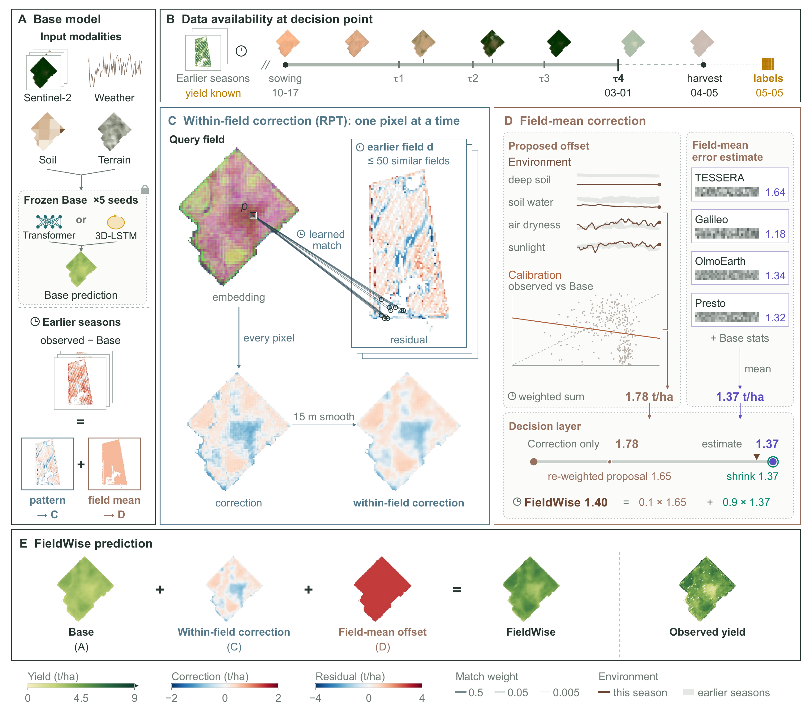
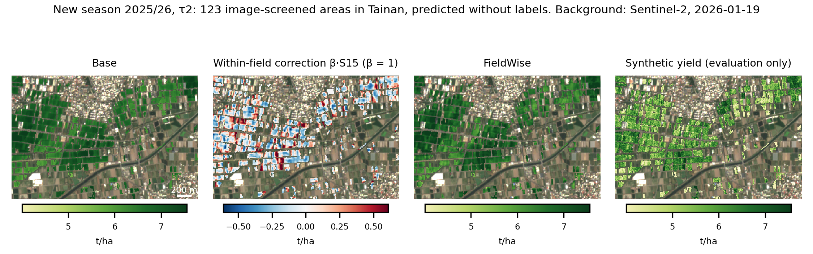

<p align="center"></p>

**FieldWise corrects pixel-level crop yield predictions for a new season before any of its yield is known, using
residual patterns and field-mean errors learned from earlier seasons.**

Reference code for *FieldWise: Explanation fidelity and decision value in residual correction of subfield crop yield
predictions* (Chan and Yang, under review) · [Quick start](#quick-start) · [Use your own data](#use-your-own-data) ·
[Citation](#citation-and-data)

The tutorial runs on **real public inputs; only the yields are synthetic**. Yield maps are rarely public, so the tutorial
generates them from the real inputs (`fieldwise/tutorial/synth.py`). Results on synthetic yields show how the code works,
not how well FieldWise works.

## How it works



Fig. 1 of the manuscript (Chan and Yang, under review): FieldWise workflow for a soybean field-season at the fourth in-season
decision time. (A) Base predictions and historical residuals. (B) Information available at the decision time. (C) Residual
pattern transfer (RPT) and 15 m smoothing. (D) Environmental and calibration offsets, foundation-model residual readouts, and
offset selection. (E) Corrected prediction and observed yield. Clock symbols mark operations using earlier seasons. Query
yield is shown only for evaluation. The example field-season is from YieldSAT (Miranda et al., 2026).

FieldWise adds two corrections to the Base prediction: a **within-field correction** β·S15, transferred from the residual
maps of similar earlier fields (RPT), and a **field-mean correction** u, chosen by a decision layer from an environmental
offset G, a calibration offset K and residual readouts of four Earth-observation foundation models (TESSERA, Galileo,
OlmoEarth, Presto). Every part is fitted on earlier seasons only.

| Panel | Step | Code | Output |
|---|---|---|---|
| A | Base predictions and historical residuals | `fieldwise/base/`, `fieldwise/tutorial/run.py` | `out/run/model/base/`, `out/run/rpt_database/bank_*` |
| B | Decision times and what is available at each | `fieldwise/schedule.py`, `fieldwise/collect/build_base_inputs.py` | `<season>/collect/base_inputs/CASES.parquet` |
| C | Reference fields, pixel match, within-field correction S15 | `fieldwise/retrieval.py`, `fieldwise/rpt.py`, `fieldwise/tutorial/descriptors.py` | `out/new/references.parquet`, `out/new/pixels.parquet` |
| D | G, K, readouts and the decision layer | `environment.py`, `calibration.py`, `readout.py`, `strength.py`, `decision.py` in `fieldwise/` | `out/new/cases.parquet` |
| E | Base + β·S15 + u = FieldWise | `fieldwise/tutorial/infer.py` | `out/new/pixels.parquet` |

`fieldwise/explain/` holds the explanation tools of the manuscript (error layers, spatial structure, decision value,
readout increments, concept erasure).

## Quick start

Needs Docker; runs on CPU. The demo inputs are seven seasons (2019/20–2025/26) of 10 image-screened areas near Renli,
Tainan, collected and encoded from public products; the last season is the new season.

```bash
git clone https://github.com/Wayne-Jan/FIELDWISE.git && cd FIELDWISE
docker build -t fieldwise .
docker run --rm fieldwise python -m unittest discover -s tests     # optional: unit and leakage tests

# demo inputs, 44 MB
curl -LO https://github.com/Wayne-Jan/FIELDWISE/releases/download/demo-data-v1/fieldwise_tainan_demo_v1.tar.gz
tar -xzf fieldwise_tainan_demo_v1.tar.gz
mkdir -p out

RUN="docker run --rm --init -v $PWD/fieldwise_tainan_demo_v1:/data:ro -v $PWD/out:/out fieldwise"
SEASONS="/data/2019 /data/2020 /data/2021 /data/2022 /data/2023 /data/2024 /data/2025"

# 1. fit: synthetic yields, Base, RPT database and corrections (the 2025/26 yields are held out)
$RUN python -m fieldwise.tutorial.run --seasons $SEASONS --target 2026 --out /out/run --seeds 42 --epochs 3
# 2. serve the new season from the saved model and database, without its yields and without refitting
$RUN python -m fieldwise.tutorial.infer --model /out/run/model --database /out/run/rpt_database --season /data/2025 --out /out/new
# 3. draw the maps
$RUN python docs/tutorial_figures.py --run /out/run --infer /out/new --season /data/2025 --stage tau2 --out /out/figures
```

The quick start uses one seed and 3 epochs to stay short; the manuscript setting is five seeds and 55 epochs
(`--seeds 42 43 44 45 46 --epochs 55`).

**What you get**

| File | Content |
|---|---|
| `out/run/model/` | Base model, RPT projection, G, K, readouts, strengths and alpha of the new season |
| `out/run/rpt_database/` | Residual database of the earlier seasons: per-pixel residuals, embeddings, field descriptors, coordinates |
| `out/run/pixels.parquet`, `out/run/cases.parquet`, `out/run/RUN.json` | Out-of-sample predictions of every season, per-year choices and the evaluation |
| `out/new/pixels.parquet` | New season per pixel: Base, within-field correction S15, Correction only, FieldWise, lon, lat |
| `out/new/cases.parquet`, `out/new/references.parquet` | New season per field: G, K, readouts, offsets; reference fields and weights |
| `out/figures/inference.png` | The maps below, for the 10 demo areas |



The new season predicted from the saved model and database, without labels, on a Sentinel-2 image of the season. This
figure was drawn from the full tutorial collection of the same area (about 120 areas per season); the quick start draws
it for its 10 areas. The synthetic yield is shown for evaluation only.

## Build from public data

To rebuild the inputs or move to another place, collect and encode each season, then fit and serve as in the quick start.
One folder per season, oldest first.

**Requirements.** An Earth Engine project (`export FIELDWISE_EE_PROJECT=<project>`, authenticated with
`earthengine authenticate`; see [Earth Engine access](https://developers.google.com/earth-engine/guides/access)); the
collection image (`docker build -f Dockerfile.collect -t fieldwise-collect .`); for encoding, the official code and weights
of [TESSERA](https://github.com/ucam-eo/tessera), [Galileo](https://github.com/nasaharvest/galileo),
[OlmoEarth](https://github.com/allenai/olmoearth_pretrain) and [Presto](https://github.com/nasaharvest/presto), installed
under their licences and listed in a JSON file with the fields of `ModelPaths` (`fieldwise/fm/encode.py`). Sentinel-1 RTC
is read from the public Microsoft Planetary Computer catalogue.

**1. Fields and dates** (see [Use your own data](#use-your-own-data)). Without farm records, the Tainan example derives
season-start and season-end proxies (SOS20 / EOS20 of Sentinel-2 NDVI) and autumn-winter growth-cycle areas from imagery;
these are retrospective proxies, not sowing or harvest dates, and the crop is not verified:

```bash
python -m fieldwise.collect.extract_s2_season raw/s2_season <x0> <y1> <w> <h> <Y>-02-01 <Y+1>-08-01
python -m fieldwise.collect.season_proxies raw/s2_season <parcels.gpkg> <Y> <cx> <cy> 10 3000 fields
```

**2. Collect** the public products (sowing year `Y`):

```bash
python -m fieldwise.collect.init_fields fields <season>/collect <Y>
for step in base soil terrain build-base lst build-environment fm rtc-pre rtc; do
  python -m fieldwise.collect $step --root <season>/collect --config <season>/collect/collection.json
done
```

**3. Encode** with the four foundation models: TESSERA per-pixel embeddings (the RPT input) and field means of the four
models (the readout input):

```bash
python -m fieldwise.collect.encode <season>/collect paths.json <season>/encode
```

**4. Fit:** synthetic yields (or yours, `--labels`), the Base of every year trained on earlier seasons only, the RPT
database of out-of-sample residuals, and the corrections, as in quick-start step 1. The new season's yields are held out of
every fit; `tests/test_leakage.py` checks that changing or removing them leaves its fits, references and predictions
unchanged.

**5. Serve** the new season as in quick-start step 2.

[`docs/DATA_COLLECTION.md`](docs/DATA_COLLECTION.md) lists every product, band and availability delay;
[`docs/INPUTS.md`](docs/INPUTS.md) defines the prepared tables, units and the timing rules that keep every fit to
information available at the decision.

## Use your own data

| You provide | Format |
|---|---|
| Field boundaries on a 10 m grid | `FIELDS.json` (`x0`, `y1`, `w`, `h`, `crs`) and `PIXELS.parquet` (`field`, `row`, `col`, `lon`, `lat`) |
| Season dates | `FIELDS.parquet` (`field`, `n_pix`, `sow_day`, `harvest_day` as UTC day numbers) |
| Crop | maize, soybean or wheat settings (`docs/DATA_COLLECTION.md`, decision times) |
| Yield maps of earlier seasons (optional) | npz with `target` (t/ha) and `gt_valid` per pixel, in the pixel order of the seasons given (as `out/run/yield_history.npz`); pass with `--labels <file>` to `fieldwise.tutorial.run` |

| The code produces | |
|---|---|
| Decision times and cases, inputs from public products | `fieldwise.collect` |
| Foundation-model embeddings | `fieldwise.collect.encode` |
| Synthetic yields (only without `--labels`), Base models, RPT database, fitted corrections | `fieldwise.tutorial.run` |
| New-season predictions | `fieldwise.tutorial.infer` |

The Base architecture and the four foundation models are fixed in this release. Fit one crop at a time.

## Citation and data

The paper, *FieldWise: Explanation fidelity and decision value in residual correction of subfield crop yield
predictions* (Chan and Yang), is under review; its citation will be added upon publication. To cite the software, see
`CITATION.cff`.

- Code: MIT (`LICENSE`).
- Demo inputs: derived from public products under their providers' terms; notices and licences in the package's
  `NOTICE.md`. The tutorial's inputs are real public data; only the yields are synthetic.
- The manuscript's results were obtained on YieldSAT (Miranda et al., 2026), available from DFKI at
  https://yieldsat.github.io/. No YieldSAT data or models trained on it are distributed here; Fig. 1 is the
  manuscript's figure of its example field-season.
- The foundation-model code and weights are not included.

Miranda, M., Pathak, D., Helber, P., Bischke, B., Najjar, H., Mena, F., Sanchez, C., Pai, A., Arenas, D.,
Valdenegro-Toro, M., Charfuelan, M., Nuske, M., Dengel, A., 2026. YieldSAT: A multimodal benchmark dataset for
high-resolution crop yield prediction. In: Proceedings of the IEEE/CVF Conference on Computer Vision and Pattern
Recognition (CVPR), pp. 22920-22930.
