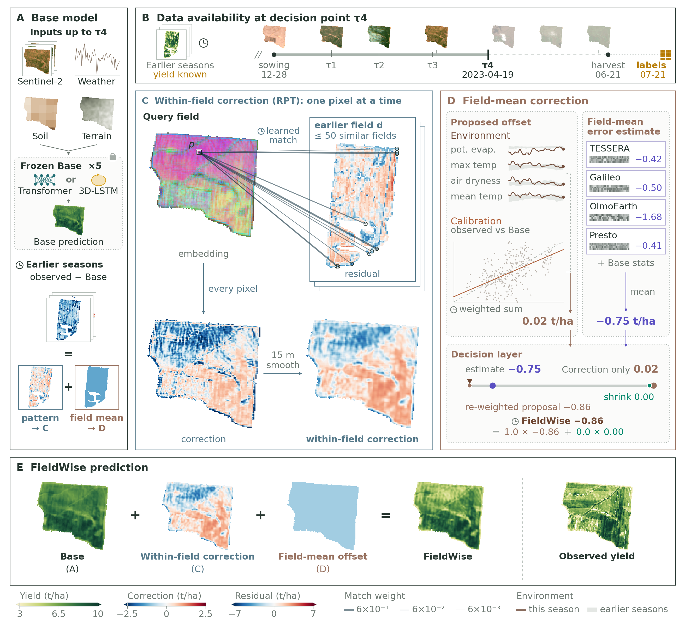

<p align="center"></p>

**FieldWise corrects pixel-level crop yield predictions for a new season before any of its yield is known, using
residual patterns and field-mean errors learned from earlier seasons.**

This repository holds the code of the FieldWise paper (Chan and Yang, under review) and an end-to-end tutorial on real
public inputs with synthetic yields. The tutorial demonstrates the pipeline; the manuscript reports FieldWise's
performance on YieldSAT.

## How it works



*Fig. 3 of the manuscript: FieldWise on a maize field-season from YieldSAT (Miranda et al., 2026) at the fourth in-season
decision τ4 (2023, Transformer Base). Clocks mark components fitted on earlier seasons.*

FieldWise adds two corrections to a Base prediction: a **within-field correction** β·S15, transferred from the residual
maps of similar earlier fields (residual pattern transfer, RPT), and a **field-mean correction** u, chosen by a decision
layer from an environmental offset G, a calibration offset Cal (K in the equations) and residual readouts of four Earth-observation foundation
models. Every part is fitted on earlier seasons only.

| Panel | Step | Code |
|---|---|---|
| A | Base model (Transformer or 3D-LSTM) and the residuals of earlier seasons | `fieldwise/base/` |
| B | Information available by each decision time; earlier-season yield labels enter 30 days after harvest | `fieldwise/schedule.py` |
| C | Within-field correction by RPT: similar earlier fields, learned pixel match, 15 m smoothing (S15) | `fieldwise/retrieval.py`, `fieldwise/rpt.py` |
| D | Field-mean correction: environmental (G) and calibration (Cal) offsets, foundation-model readouts and the decision layer | `environment.py`, `calibration.py`, `readout.py`, `decision.py` in `fieldwise/` |
| E | FieldWise prediction: Base + β·S15 + u | `fieldwise/tutorial/infer.py` |

`fieldwise/explain/` holds the explanation analyses of the manuscript.

## Quick start

Needs Docker; runs on CPU. The demo inputs are seven seasons (2019/20–2025/26) of 10 areas near Tainan, Taiwan; the last
season is the new one.

```bash
git clone https://github.com/Wayne-Jan/FIELDWISE.git && cd FIELDWISE
docker build -t fieldwise .
docker run --rm fieldwise python -m unittest discover -s tests     # optional: unit and leakage tests

# demo inputs, 44 MB
curl -LO https://github.com/Wayne-Jan/FIELDWISE/releases/download/demo-data-v1/fieldwise_tainan_demo_v1.tar.gz
tar -xzf fieldwise_tainan_demo_v1.tar.gz
mkdir -p out

RUN="docker run --rm --init -v $PWD/fieldwise_tainan_demo_v1:/data:ro -v $PWD/out:/out fieldwise"
SEASONS="/data/2019 /data/2020 /data/2021 /data/2022 /data/2023 /data/2024 /data/2025"

# 1. fit: synthetic yields, Base, RPT database and corrections (the 2025/26 yields are held out)
$RUN python -m fieldwise.tutorial.run --seasons $SEASONS --target 2026 --out /out/run --seeds 42 --epochs 3
# 2. serve the new season from the saved model and database, without its yields and without refitting
$RUN python -m fieldwise.tutorial.infer --model /out/run/model --database /out/run/rpt_database --season /data/2025 --out /out/new
# 3. draw the maps
$RUN python docs/tutorial_figures.py --run /out/run --infer /out/new --season /data/2025 --stage tau2 --out /out/figures
```


The new season predicted without its yields (shown here for the full tutorial collection of about 120 areas; the quick
start draws its 10). `out/run` holds the fitted model and the RPT database, `out/new` the new season per pixel and field
([files](docs/INPUTS.md#12-tutorial-files)). The manuscript setting is five seeds and 55 epochs
(`--seeds 42 43 44 45 46 --epochs 55`).

## Build your own

One folder per season, oldest first. Build the collection and encoding images, then open the collection image with your
[Earth Engine](https://developers.google.com/earth-engine/guides/access) project:

```bash
docker build -f Dockerfile.collect -t fieldwise-collect .
docker build -f Dockerfile.encode -t fieldwise-encode .
export FIELDWISE_EE_PROJECT=<your project>     # after earthengine authenticate
docker run --rm -it -e FIELDWISE_EE_PROJECT -e PYTHONPATH=/workspace/FIELDWISE \
  -v ~/.config/earthengine:/root/.config/earthengine:ro -v $PWD/work:/work -w /work fieldwise-collect bash
```

1. **Fields and dates.** Your field boundaries and season dates ([format](docs/INPUTS.md#12-tutorial-files)), or, as in
   the Tainan demo, areas and season dates estimated from Sentinel-2 NDVI:
   ```bash
   python -m fieldwise.collect.extract_s2_season raw/s2_season <x0> <y1> <w> <h> <Y>-02-01 <Y+1>-08-01
   python -m fieldwise.collect.season_proxies raw/s2_season <parcels.gpkg> <Y> <cx> <cy> 10 3000 fields
   ```
2. **Collect** the public products of sowing year `Y` ([products](docs/DATA_COLLECTION.md)):
   ```bash
   python -m fieldwise.collect.init_fields fields <season>/collect <Y>
   for step in base soil terrain build-base lst build-environment fm rtc-pre rtc; do
     python -m fieldwise.collect $step --root <season>/collect --config <season>/collect/collection.json
   done
   ```
3. **Encode** with the four foundation models in the encoding image, from the host; a GPU is recommended
   ([models](docs/FOUNDATION_MODELS.md)):
   ```bash
   docker run --rm --init --gpus all -v $PWD/work/<season>:/season fieldwise-encode \
     python -m fieldwise.collect.encode /season/collect /opt/fm/paths.json /season/encode
   ```
4. **Fit and serve** as in the quick start. Pass your yield maps with `--labels`; without them the tutorial generates
   synthetic yields. `tests/test_leakage.py` checks that the new season's yields never enter a fit.

Table formats and the timing rules that keep every fit to information available at the decision:
[docs/INPUTS.md](docs/INPUTS.md).

## Citation, data and licences

- **Paper:** *FieldWise: Explanation fidelity and decision value in residual correction of subfield crop yield
  predictions* (Chan and Yang), under review; its citation will be added upon publication. To cite the software, see
  `CITATION.cff`.
- **Data:** the manuscript's experiments use YieldSAT (Miranda et al., 2026), available from DFKI at
  https://yieldsat.github.io/.
- **Foundation models:** please cite TESSERA (Feng et al., 2026), Galileo (Tseng et al., 2025), OlmoEarth (Herzog et al.,
  2026) and Presto (Tseng et al., 2023) when you use the encoders; each keeps its own licence
  ([versions and licences](docs/FOUNDATION_MODELS.md#versions-and-licences)).
- **Licences:** code MIT (`LICENSE`); demo inputs under their providers' terms (`NOTICE.md` in the package).

<details>
<summary>References</summary>

Feng, Z., Atzberger, C., Jaffer, S., Knezevic, J., Sormunen, S., Young, R., Lisaius, M.C., Immitzer, M., Jackson, T.,
Ball, J., Coomes, D.A., Madhavapeddy, A., Blake, A., Keshav, S., 2026. TESSERA: Temporal embeddings of surface spectra
for Earth representation and analysis. In: Proceedings of the IEEE/CVF Conference on Computer Vision and Pattern
Recognition (CVPR), pp. 34818-34831.

Herzog, H., Bastani, F., Zhang, Y., Tseng, G., Redmon, J., Sablon, H., Park, R., Morrison, J., Buraczynski, A.,
Farley, K., Hansen, J., Howe, A., Johnson, P.A., Otterlee, M., Schmitt, T., Pitelka, H., Daspit, S., Ratner, R.,
Wilhelm, C., Wood, S., Jacobi, M., Kerner, H., Shelhamer, E., Farhadi, A., Krishna, R., Beukema, P., 2026. OlmoEarth:
Stable latent image modeling for multimodal Earth observation. In: Proceedings of the IEEE/CVF Conference on Computer
Vision and Pattern Recognition (CVPR), pp. 34806-34817.

Miranda, M., Pathak, D., Helber, P., Bischke, B., Najjar, H., Mena, F., Sanchez, C., Pai, A., Arenas, D.,
Valdenegro-Toro, M., Charfuelan, M., Nuske, M., Dengel, A., 2026. YieldSAT: A multimodal benchmark dataset for
high-resolution crop yield prediction. In: Proceedings of the IEEE/CVF Conference on Computer Vision and Pattern
Recognition (CVPR), pp. 22920-22930.

Tseng, G., Cartuyvels, R., Zvonkov, I., Purohit, M., Rolnick, D., Kerner, H., 2023. Lightweight, pre-trained
transformers for remote sensing timeseries. In: NeurIPS 2023 Workshop on Tackling Climate Change with Machine Learning.
https://www.climatechange.ai/papers/neurips2023/58

Tseng, G., Fuller, A., Reil, M., Herzog, H., Beukema, P., Bastani, F., Green, J.R., Shelhamer, E., Kerner, H.,
Rolnick, D., 2025. Galileo: Learning global & local features of many remote sensing modalities. In: Proceedings of the
42nd International Conference on Machine Learning, PMLR 267, pp. 60280-60300.

</details>

## AI use

The code and documentation in this repository were written with the assistance of AI coding tools, Claude Code
(Anthropic) and Codex (OpenAI). The authors designed the method, reviewed and tested the code, and take
responsibility for its content.
